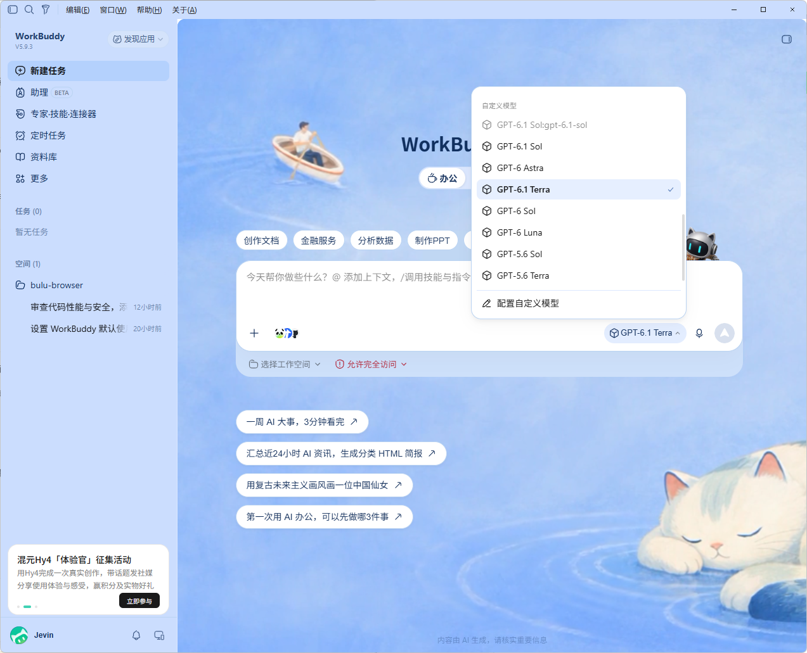

# WorkBuddy ChatGPT 连接器

在 WorkBuddy 中登录 ChatGPT，选择显示的模型，并在对话中调整支持的思考强度。



> **仅供学习和研究。** 安装会备份并修改 WorkBuddy 安装文件与模型配置，可能影响原厂签名校验。请了解风险后谨慎使用。本项目与 WorkBuddy、腾讯及 OpenAI 无官方关联。

## 安装

1. [下载安装程序 0.4.2](downloads/WorkBuddy-ChatGPT-Setup-0.4.2-preview.exe)。
2. 退出 WorkBuddy，双击安装程序并按提示授权管理员权限。
3. 在 WorkBuddy 的 **设置 → 模型 → 登录ChatGPT** 完成登录，选择需要显示的模型。
4. 在对话的模型选择器中调整模型支持的思考强度。

当前针对 Windows 和 WorkBuddy 5.9.3 测试。模型和档位取决于账号与服务返回；支持文本及函数工具调用，图像和音频尚未接入。安装器为预览版，建议提前备份重要数据。

在 Windows 开始菜单选择 **卸载 WorkBuddy ChatGPT**，退出 WorkBuddy 后可恢复备份的程序文件。登录资料和备份会保留。

## 工作原理

安装器在 WorkBuddy 模型设置中添加登录入口，同时启动本机连接服务。用户通过官方授权页面登录，凭据由 Windows 当前用户的 DPAPI 加密保存。服务读取账号返回的模型目录，将选中模型写入 WorkBuddy 自定义模型配置，再把对话请求转换为上游 Responses 请求。桥接仅监听本机地址，推理接口使用独立的本地密钥。

## 开发

源码位于 [workbuddy-chatgpt](workbuddy-chatgpt/)，需要 Windows、Node.js 24：

```powershell
cd workbuddy-chatgpt
npm ci --ignore-scripts
npm test
```

安装包构建运行 `./installer/build-exe.ps1`，需要 Windows 的 .NET Framework C# 编译器。部分测试需要 WorkBuddy 5.9.3 原始文件备份，请先阅读测试内容。

## 许可与转载

作者：[Jevin0201](https://github.com/Jevin0201)。仅允许非商业学习、研究与分享；转载、搬运或修改后发布须注明作者、来源与修改情况。完整条款见 [LICENSE](LICENSE)。本许可不符合开源促进会的开源定义。第三方组件依各自许可使用，详见 [第三方说明](THIRD_PARTY.md)。
